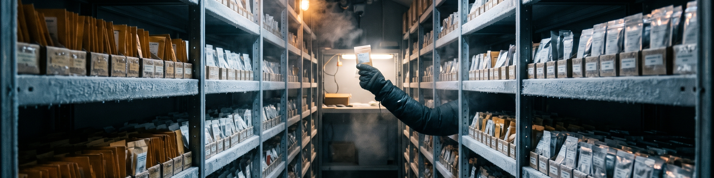

# Obsidian-Vault

This repo is my Obsidian vault: the storehouse where my linked notes live. It is the one place my reading, research, and project notes are kept together as plain Markdown, written to be linked to each other, so a note earns its place by what it connects to and not just by where it sits.

This commit is the seed. The vault starts here as a declared structure: this README stating the purpose and the layout, and the starting folders below, each held by a `.gitkeep` file until real notes land in it. There are no notes in the vault yet, and nothing here pretends otherwise. Notes get added as they are written, and the folders fill in from real use rather than from a bulk import.

## Layout

- `Inbox/`: capture first. New notes land here unsorted, and get linked, renamed, or moved once they have a shape.
- `Notes/`: the main body of the vault. Finished notes that stand on their own and link out to the rest.
- `Daily/`: daily notes, one per day, where the day's loose ends are gathered before anything is filed properly.
- `Projects/`: notes that belong to a live project, kept together while the work is running.
- `References/`: source material and the notes taken from it: books, papers, talks, and pages the other notes draw on.
- `Templates/`: the starting shapes for new notes, so a daily note or a source note begins from the same frame every time.
- `Attachments/`: images and files that notes link to, kept inside the vault so the links hold.
- `Archive/`: retired notes. Nothing is deleted outright; what stops being current moves here and stays readable.

## How the vault is kept

The vault is plain files on purpose: Markdown that any editor can read, no database, nothing locked inside one app. Obsidian is the working surface, and the links between notes are the structure that matters. The vault's Obsidian configuration is tracked separately in the Obsidian-Vault-Config repo.

